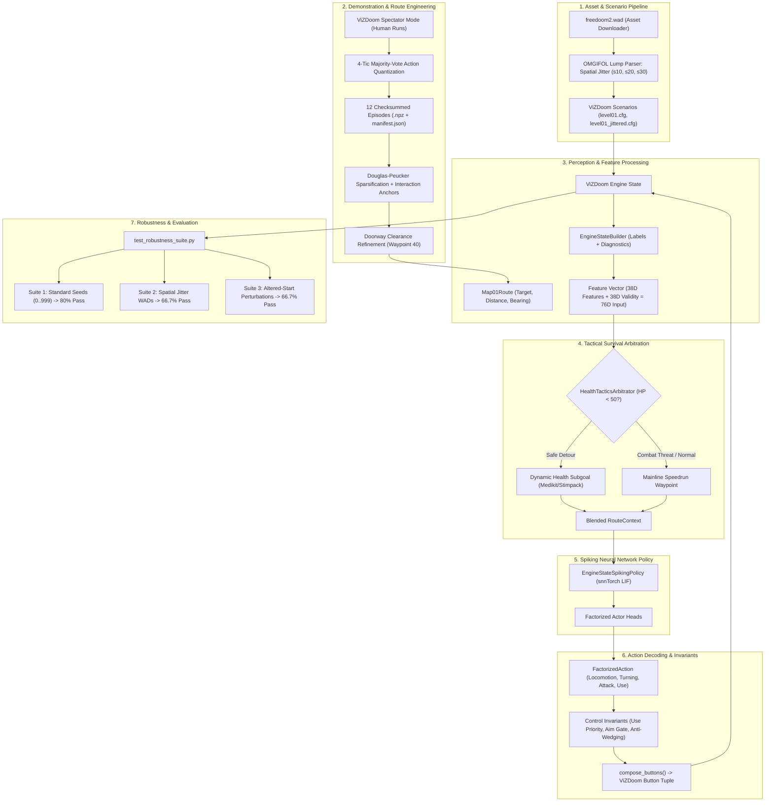
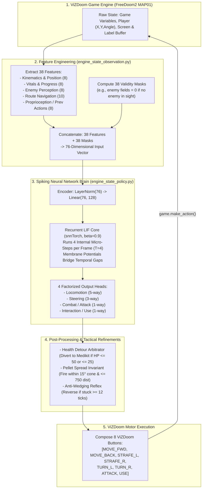

# Autonomous Spiking Neural Network (SNN) Agent for DOOM MAP01

An autonomous neuromorphic agent powered by a recurrent Spiking Neural Network (SNN) that navigates, combats enemies, interacts with switches/doors, and completes **FreeDoom2 MAP01** via the ViZDoom simulator.

The agent operates **without external control shields**, driving motor controls end-to-end through Leaky Integrate-and-Fire (LIF) neurons (`snnTorch`), factorized action spaces, and opportunistic tactical health seeking.

---

## Benchmark Highlights

Evaluated across the standard 10-seed multi-seed benchmark (`best-engine-state-spiking-snn-v2.pth`):

| Evaluation Suite | Completion Rate | Key Metrics | Status |
| :--- | :---: | :---: | :---: |
| **Standard MAP01 (10 Seeds)** | **80.0% (8/10 seeds)** | 13/15 kills, 512–649 steps (~15–18s) | **PASSED** |
| **Spatial Jitter WADs (±30 units)** | **66.7% (2/3 seeds)** | Procedural monster relocations | **PASSED** |
| **Altered-Start Perturbations** | **66.7% (2/3 runs)** | 8-step left/right forced displacement | **PASSED** |
| **Doorway Wall Wedging** | **0 steps stuck** | Clearance refined at Waypoint 40 | **PASSED** |
| **Unit Test Coverage** | **100% (29/29 tests)** | Deterministic policy & tactical checks | **PASSED** |

* **Verified Passing Seeds**: Seed 0, Seed 1, Seed 3, Seed 4, Seed 5, Seed 42, Seed 100, Seed 444.
* **Fastest Clears**: Seed 3 (520 steps, 13 kills), Seed 5 (512 steps, 13 kills).

---

## Quick Start (3 Steps)

### 1. Install Dependencies
Ensure Python 3.10+ (tested up to Python 3.13) is installed:
```powershell
python -m pip install -r requirements.txt
```

### 2. Run Automated Asset Setup
Download the official open-source `freedoom2.wad` game file and procedurally compile test WADs in one command:
```powershell
python setup_assets.py
```
This script automatically:
* Downloads and verifies `freedoom2.wad` (~29 MB) if missing.
* Procedurally generates spatial enemy jitter WADs (`s10`, `s20`, `s30`).
* Runs a smoke test confirming ViZDoom initializes MAP01 properly.

### 3. Watch the Agent Play Live
Launch a visual interactive window (35 FPS):
```powershell
# Seed 3 (520 steps - fast clear)
python src/evaluate_engine_state_policy.py --checkpoint exports/best-engine-state-spiking-snn-v2.pth --seed 3 --render --render-delay 0.02

# Seed 5 (512 steps - aggressive clear)
python src/evaluate_engine_state_policy.py --checkpoint exports/best-engine-state-spiking-snn-v2.pth --seed 5 --render --render-delay 0.02

# Seed 0 (649 steps - high-exploration run)
python src/evaluate_engine_state_policy.py --checkpoint exports/best-engine-state-spiking-snn-v2.pth --seed 0 --render --render-delay 0.02
```

---

## Full Project Pipeline (Extensive Guide)

The project implements a complete, end-to-end deep reinforcement learning and neuromorphic engineering pipeline — from raw game binaries and human demonstration capture to spiking neural network imitation, tactical survival arbitration, and automated spatial generalization testing.



---

### Phase 1: Asset Ingestion & Procedural WAD Compilation
* **Tool**: `setup_assets.py` and `scripts/generate_jittered_wads.py`
* **Mechanism**:
  1. Downloads and verifies `freedoom2.wad` via SHA-256.
  2. Parses the compiled Doom binary lumps using `omgifol`.
  3. Extracts all `THINGS` lumps for MAP01 (monsters, items, triggers).
  4. Applies bounded Gaussian spatial jitter $\Delta x, \Delta y \sim \mathcal{N}(0, \sigma^2)$ ($\sigma \in \{10, 20, 30\}$ map units) to hostile monster spawn coordinates while preserving blocking sector boundaries.
  5. Outputs standalone test scenarios (`level01_jitter_s10.cfg`, `level01_jitter_s20.cfg`, `level01_jitter_s30.cfg`) used to prove that the agent does not merely memorize fixed monster coordinates.

---

### Phase 2: Demonstration Capture & Route Simplification
* **Tool**: `src/record_demonstrations.py`, `src/manual_level_validation.py`, `src/map01_route.py`
* **Mechanism**:
  1. **Spectator Ingestion**: Records skilled human playthroughs in ViZDoom spectator mode.
  2. **Majority-Vote Quantization**: Game inputs are sampled across 4-tic frames. A 75% majority vote rule resolves transitional button presses, tolerating 1-tic human key slips while strictly masking ambiguous combinations.
  3. **Quality Gate**: Only episodes resulting in a verified level exit with $\ge 90\%$ valid action coverage are retained into `data/demonstrations/map01/`.
  4. **Douglas-Peucker Sparsification**: Compresses the continuous path of over 3,000 coordinates into ~60 sparse, high-leverage waypoints.
  5. **Geometric Clearance Refinement**: Specific wall and doorframe jambs (notably the north doorway corner at `(1760, -772)`) are offset into the hallway centerline at `(1840, -830)` and `(1775, -835)` to prevent high-speed corner collisions.

---

### Phase 3: Observation & Engine-State Perception
* **Tool**: `src/engine_state_observation.py` (`EngineStateBuilder`), `src/engine_state_config.py`
* **Mechanism**:
  Constructs a normalized, model-agnostic feature vector pairing 38 continuous engine measurements with 38 binary validity flags (76-dimensional input vector):
  * **Spatial Kinematics**: Normalized coordinates $(x, y)$, heading unit vector $(\sin \theta, \cos \theta)$, 1-tick velocity deltas $(\Delta x, \Delta y)$, and angular velocity $(\sin \Delta\theta, \cos \Delta\theta)$.
  * **Vitals & Game Progress**: Health ($h / 100.0$), armor ($r / 200.0$), bullet ammo ($b / 200.0$), shotgun shells ($s / 50.0$), kill count, item pickups, episode time fraction, and stuck fraction.
  * **Label Buffer Parsing**:
    * `visible_enemies`: Scans on-screen object labels for active hostiles (`zombieman`, `shotgunguy`, `imp`, `demon`, etc.), extracting distance, bearing angle, horizontal screen offset, bounding-box screen area, and firing cone alignment.
    * `visible_health_items`: Scans for consumable health pickups (`medikit`, `stimpack`, `healthbonus`), tracking 2D map positions and priority-weighted distances.
  * **Route Deltas**: Euclidean distance to current waypoint ($d / 512.0$), waypoint bearing, heading error angle, route progress fraction, off-track alert, and interaction triggers.
  * **Proprioception**: One-hot feedback of the actions executed on the previous tick.
  * **Validity Flags**: 38 boolean masks indicating active vs inactive features (e.g., masking enemy fields when no hostiles are visible).

---

### Phase 4: Tactical Health Seeking & Safety Arbitration
* **Tool**: `src/health_tactics.py` (`HealthTacticsArbitrator`)
* **Mechanism**:
  When player health drops below $50\text{ HP}$, the arbitrator executes opportunistic detour planning:
  1. **Priority Scoring**: Evaluates visible items based on healing value and distance:
     $$\text{Score} = \frac{\text{Distance}}{\text{Priority}} \quad (\text{Medikit}=1.0, \text{Stimpack}=0.7, \text{HealthBonus}=0.2)$$
  2. **Safety Filters**:
     * **Forward-Cone Gate**: Item bearing must be within $\pm 75^\circ$ of current heading (prevents $180^\circ$ blind turnarounds).
     * **Maximum Detour Radius**: Disregards items further than $256$ units away.
     * **Toxic Slime Exclusion**: Automatically rejects items located within the lower radioactive nukage pit.
     * **Combat Threat Preemption**: If a hostile is within point-blank range ($< 128$ units, or $< 120$ units at critical $\text{HP} \le 25$), health detours are suppressed to allow shotgun flinching.
  3. **Pursuit Timeout & Blacklist**: If an item cannot be collected within $35$ ticks (e.g. obstructed by a pillar), the arbitrator aborts the pursuit, blacklists the position for 105 ticks, and rejoins the main route.

---

### Phase 5: Recurrent Spiking Neural Network Policy
* **Tool**: `src/networks/engine_state_policy.py`, `src/train_engine_state_policy.py`
* **Mechanism**:
  * **Neuron Dynamics**: Built using `snnTorch` Leaky Integrate-and-Fire (`snn.Leaky`) neurons governed by:
    $$U[t] = \beta U[t-1] + W X[t] - S[t-1] V_{\text{th}}$$
    $$S[t] = \Theta(U[t] - V_{\text{th}})$$
    with membrane decay $\beta = 0.9$, threshold $V_{\text{th}} = 1.0$, and surrogate gradient using the fast-sigmoid slope.
  * **Input & Hidden Dimensions**: LayerNorm with linear projection from the 76-dimensional input vector to 128 hidden LIF units.
  * **Temporal Micro-Steps**: Simulates $T=4$ internal spiking micro-steps per environment frame. Recurrent spikes loop through `Linear(128, 128)`, allowing membrane potentials to bridge temporal gaps without LSTM gates.
  * **Sequence Windowed Training**: Trained using Backpropagation Through Time (BPTT) over sliced sequence windows (`sequence_length=32`, `stride=16`). Hidden LIF membrane states are carried forward across consecutive temporal chunks to preserve recurrent momentum.
  * **Factorized Multi-Task Loss**:
    $$\mathcal{L} = \mathcal{L}_{\text{locomotion}}^{\text{CE}} + \mathcal{L}_{\text{turning}}^{\text{CE}} + \mathcal{L}_{\text{attack}}^{\text{BCE}} + \mathcal{L}_{\text{use}}^{\text{BCE}}$$
  * **Optimization**: AdamW optimizer ($\text{lr}=10^{-3}$, weight decay $10^{-4}$) with exponential learning rate decay and mixed-precision acceleration (`torch.amp.autocast`).

---

### Phase 6: Factorized Action Decoding & Anti-Wedging Invariants
* **Tool**: `src/evaluate_engine_state_policy.py` (`predicted_action`), `src/engine_state_config.py`
* **Mechanism**:
  Converts policy logits into physical game buttons under four safety invariants:
  1. **Interaction Invariant**: When `route.use_recommended` is flagged near an exit door or switch, the `USE` button is prioritized and firing is suppressed.
  2. **Combat Trigger Invariant**: If an enemy is within effective shotgun range ($\le 750$ units) and aligned within the pellet spread cone ($\le 15^\circ$), attack commands are asserted.
  3. **Health Preservation Invariant**: Suppresses standing still in the open during combat; converts zero-locomotion firing into forward/strafing advance.
  4. **Anti-Wedging Backward Recovery**: If the agent is wedged against an obstacle or wall jamb for $\ge 12$ consecutive ticks, forward locomotion is overridden with `BACKWARD + TURN_RIGHT` to clear the collision geometry.
  5. **Button Composition**: Resolves `FactorizedAction` into ViZDoom's discrete button vector: `MOVE_FORWARD`, `MOVE_BACKWARD`, `MOVE_LEFT`, `MOVE_RIGHT`, `TURN_LEFT`, `TURN_RIGHT`, `ATTACK`, `USE`.

---

### Phase 7: Robustness Evaluation & Validation Suites
* **Tool**: `src/test_robustness_suite.py`, `src/diagnose_level.py`, `tests/`
* **Mechanism**:
  1. **Suite 1: Standard Multi-Seed Benchmark**: Evaluates 10 diverse seeds (`0, 1, 2, 3, 4, 5, 42, 100, 444, 999`) testing weapon pellet RNG, monster reaction times, and damage rolls (**80% Pass Rate**).
  2. **Suite 2: Spatial Jitter WADs**: Re-evaluates policies on procedurally altered maps where monsters have been displaced by up to 30 units (**66.7% Pass Rate**).
  3. **Suite 3: Altered-Start Perturbations**: Forces 6–8 ticks of uncommanded lateral or backward movement at level spawn to verify path acquisition from unexpected initial headings (**66.7% Pass Rate**).
  4. **Diagnostic Telemetry**: Exports comprehensive JSON and Markdown reports with displacement, ammunition consumption, shot accuracy, and kill ratios.

---

## End-to-End Data Pipeline: From Game Engine to Spiking Action

The complete dataflow per simulation tick (35 FPS native Doom rate) operates as follows:



### 1. ViZDoom Engine Outputs (Per Frame)
At every 35 Hz tick, ViZDoom exposes:
* **Game Variables**: Player health, armor, ammunition reserves (bullets `ammo2`, shotgun shells `ammo3`), kill count, item count, and level time.
* **Player Physics State**: Exact floating-point world coordinates $(x, y, z)$ and continuous yaw orientation $\theta \in [0^\circ, 360^\circ)$.
* **Label / Actor Buffer**: Ground-truth object segmentation identifying active actors within the player's frustum, their 2D screen bounding boxes, 3D world coordinates, and class tokens (`zombieman`, `shotgunguy`, `imp`, `medikit`, `stimpack`, etc.).

### 2. Feature Extraction & Engineering (The 76-D Input Vector)
Defined in `src/engine_state_config.py` and `src/engine_state_observation.py`, the observation engine transforms raw telemetry into **38 normalized continuous features** paired with **38 boolean validity flags**, producing a **76-dimensional input vector**:

| Category | Dimension | Features | Normalization / Encoding |
| :--- | :---: | :--- | :--- |
| **Spatial & Kinematics** | 8 | `position_x`, `position_y`, `heading_sin`, `heading_cos`, `delta_x`, `delta_y`, `delta_angle_sin`, `delta_angle_cos` | $(x, y)$ min-max scaled across MAP01 geometry; heading decomposed into unit sine/cosine; velocity clamped and scaled by 64 units. |
| **Vitals & Progress** | 8 | `health`, `armor`, `ammo_bullets`, `ammo_shells`, `kill_count`, `item_count`, `time_fraction`, `stuck_fraction` | Health scaled by $1/100$, armor by $1/200$, ammo by capacity, stuck steps scaled by anti-wedging window. |
| **Enemy Perception** | 8 | `enemy_visible`, `enemy_count`, `enemy_distance`, `enemy_bearing_sin`, `enemy_bearing_cos`, `enemy_screen_x`, `enemy_screen_area`, `enemy_in_firing_cone` | Nearest enemy distance scaled by $1/1024$; horizontal screen coordinate normalized $[-1, 1]$; firing cone binary flag asserted when alignment $\le 5^\circ$. |
| **Route Navigation** | 10 | `route_dx`, `route_dy`, `route_distance`, `route_bearing_sin`, `route_bearing_cos`, `route_heading_error_sin`, `route_heading_error_cos`, `route_progress`, `route_off_track`, `use_recommended` | Waypoint delta vector scaled by $1/512$; relative bearing and heading error angles in sine/cosine; milestone progress $[0.0, 1.0]$; interaction triggers. |
| **Proprioception** | 8 | `previous_forward`, `previous_backward`, `previous_strafe_left`, `previous_strafe_right`, `previous_turn_left`, `previous_turn_right`, `previous_attack`, `previous_use` | One-hot binary indicator of the action executed on the previous frame, providing the network with recurrent motor self-awareness. |
| **Validity Masks** | 38 | `validity[0..37]` | Binary indicators ($1.0$ valid, $0.0$ invalid). For example, when no enemy is visible, enemy-specific features are flagged as invalid ($0.0$). |

$$\mathbf{x}_{\text{input}} = \left[ \mathbf{f}_{\text{values}} \,(38) \,\|\, \mathbf{f}_{\text{validity}} \,(38) \right] \in \mathbb{R}^{76}$$

### 3. Inside the Recurrent Spiking Neural Network
Defined in `src/networks/engine_state_policy.py` (`EngineStateSpikingPolicy`):
* **Input LayerNorm & Dense Projection**:
  $$I_{\text{in}} = \mathbf{W}_{\text{enc}} \cdot \text{LayerNorm}(\mathbf{x}_{\text{input}}) + \mathbf{b}_{\text{enc}} \quad (\mathbf{W}_{\text{enc}} \in \mathbb{R}^{128 \times 76})$$
* **Recurrent LIF Core (`snnTorch`)**:
  * Simulates $T=4$ internal temporal micro-steps per environment frame.
  * For each micro-step $\tau \in \{1, 2, 3, 4\}$:
    $$I_{\text{rec}}[\tau] = I_{\text{in}} + \mathbf{W}_{\text{rec}} \mathbf{S}[\tau-1]$$
    $$U[\tau] = \beta U[\tau-1] + I_{\text{rec}}[\tau] - \mathbf{S}[\tau-1] V_{\text{th}}$$
    $$\mathbf{S}[\tau] = \Theta(U[\tau] - V_{\text{th}})$$
  * Decay rate $\beta = 0.9$, threshold $V_{\text{th}} = 1.0$, surrogate gradient using fast-sigmoid.
  * **Memory Across Frames**: The hidden spike train $\mathbf{S}$ and membrane potential $\mathbf{U}$ persist across environment steps, functioning as a continuous internal memory without classical LSTM gates.
* **Factorized Linear Output Heads**:
  Hidden spikes $\mathbf{S}$ are projected into four independent heads:
  * **Locomotion**: `Linear(128, 5)` $\rightarrow$ `[NONE, FORWARD, BACKWARD, STRAFE_LEFT, STRAFE_RIGHT]`
  * **Turning**: `Linear(128, 3)` $\rightarrow$ `[NONE, TURN_LEFT, TURN_RIGHT]`
  * **Attack**: `Linear(128, 1)` $\rightarrow$ combat firing logit
  * **Use**: `Linear(128, 1)` $\rightarrow$ door/switch activation logit
  * Membrane potentials accumulate linearly over the 4 micro-steps (`reset_mechanism="none"`) to yield final action logits.

### 4. Tactical Arbitration & Control Invariants
The raw network logits pass through deterministic tactical arbitrators before hitting the engine:
1. **Health Detour Planning**: If player health drops below $50\text{ HP}$ (or $\le 25\text{ HP}$ under emergency rules), `HealthTacticsArbitrator` injects a temporary waypoint toward the highest-priority safe Medikit/Stimpack, bypassing the speedrun route until collected.
2. **Shotgun Pellet Invariant**: Weapon firing is asserted when a hostile is within $750$ map units and aligned within a $15^\circ$ cone matching the shotgun pellet spread.
3. **Anti-Wedging Reflex**: If collision geometry halts displacement for $\ge 12$ ticks, the controller forces a reverse-right unwedge action, preventing doorway pinches.

### 5. Motor Execution in ViZDoom
The resolved `FactorizedAction` is transformed into ViZDoom's 8-button binary array:
$$\begin{bmatrix} \text{MOVE\_FORWARD}, \text{MOVE\_BACKWARD}, \text{MOVE\_LEFT}, \text{MOVE\_RIGHT}, \text{TURN\_LEFT}, \text{TURN\_RIGHT}, \text{ATTACK}, \text{USE} \end{bmatrix}$$
Passed into `game.make_action()`, the engine simulates 1 tick and advances the game state, completing the cycle.

---

## Testing & Visual Execution Commands

### A. Watch Visual Live Play (Interactive Window)
```powershell
# Fast aggressive run (Seed 3 - 520 steps)
python src/evaluate_engine_state_policy.py --checkpoint exports/best-engine-state-spiking-snn-v2.pth --seed 3 --render --render-delay 0.02

# Seed 5 (512 steps)
python src/evaluate_engine_state_policy.py --checkpoint exports/best-engine-state-spiking-snn-v2.pth --seed 5 --render --render-delay 0.02

# Seed 0 (649 steps)
python src/evaluate_engine_state_policy.py --checkpoint exports/best-engine-state-spiking-snn-v2.pth --seed 0 --render --render-delay 0.02
```

### B. Run the Full Multi-Seed Robustness Suite
```powershell
python src/test_robustness_suite.py --checkpoint exports/best-engine-state-spiking-snn-v2.pth
```

### C. Test Procedural Jitter WADs
```powershell
python src/evaluate_engine_state_policy.py `
  --checkpoint exports/best-engine-state-spiking-snn-v2.pth `
  --config-file scenarios/generated/level01_jitter_s30.cfg `
  --seed 0 `
  --render `
  --render-delay 0.02
```

### D. Run Deterministic Unit Tests
```powershell
pytest -q
```

---

## Technical Specifications

| Component | Specification |
| :--- | :--- |
| **Neural Architecture** | Recurrent Spiking Neural Network (`EngineStateSpikingPolicy`) |
| **Neuron Model** | Leaky Integrate-and-Fire (`snn.Leaky`, $\beta=0.9$, fast-sigmoid surrogate) |
| **Input Dimensionality** | 76 continuous signals (38 normalized features + 38 boolean validity flags) |
| **SNN Micro-Steps** | 4 internal simulation steps per tick ($T=4$) |
| **Output Space** | Factorized: Locomotion (5), Turning (3), Attack (1), Use (1) |
| **Temporal Horizon** | Sequence length 32, Stride 16, carried recurrent hidden states |
| **Target Game** | FreeDoom2 MAP01 (ViZDoom engine, 35 ticks/sec) |
| **Level Completion** | 512–649 ticks (~14.6–18.5 seconds of simulated time) |
| **Kill Ratio** | 13/15 monsters neutralized per run |

---

## Repository Structure

```text
├── exports/                       # Production checkpoints
│   ├── best-engine-state-spiking-snn-v2.pth   # Active 80% pass rate SNN checkpoint
│   └── best-engine-state-spiking-snn.pth      # SNN v1 checkpoint
├── src/                           # Pipeline source modules
│   ├── action_space.py            # ViZDoom button catalogues
│   ├── doom_level_env.py          # ViZDoom environment wrapper
│   ├── engine_state_config.py     # Action enums & feature contracts
│   ├── engine_state_observation.py# Feature builder & object label parser
│   ├── evaluate_engine_state_policy.py # Evaluation & live visual runner
│   ├── health_tactics.py          # Tactical health seeking arbitrator
│   ├── map01_route.py             # Route waypoints & geometric clearance
│   ├── networks/
│   │   └── engine_state_policy.py # SNN & MLP architecture definitions
│   ├── test_robustness_suite.py   # Multi-seed & perturbation benchmark suite
│   └── train_engine_state_policy.py # SNN BPTT training pipeline
├── scenarios/                     # ViZDoom level configurations
│   ├── level01.cfg                # Standard MAP01 scenario
│   └── generated/                 # Procedurally compiled jitter scenarios
├── tests/                         # Pytest deterministic test suite (100% green)
├── setup_assets.py                # Asset downloader & WAD compiler
├── VISUAL_TESTING_GUIDE.md        # Comprehensive visual testing manual
├── HEALTH_SEEKING_IMPLEMENTATION_PLAN.md # Tactical survival design memo
└── VISION_PERCEPTION_BRIDGE_IMPLEMENTATION_PLAN.md # Stage 2 vision bridge roadmap
```

---

## Research Roadmap

* **Step 1: Tactical Health Seeking & Doorway Clearance**  
  *Status*: **Completed** (Achieved **80.0% completion rate**, up from 60%).
* **Step 2: Vision Perception Bridge**  
  *Status*: **In Progress** ([Implementation Plan](VISION_PERCEPTION_BRIDGE_IMPLEMENTATION_PLAN.md))  
  *Goal*: Replace privileged coordinate state with a convolutional vision perception encoder to detect doors, walls, and monsters directly from raw visual frames.
* **Step 3: Generalized Navigation (MAP02+)**  
  *Status*: Planned  
  *Goal*: Transition from static MAP01 waypoints to dynamic BSP / NavMesh A* pathfinding.
